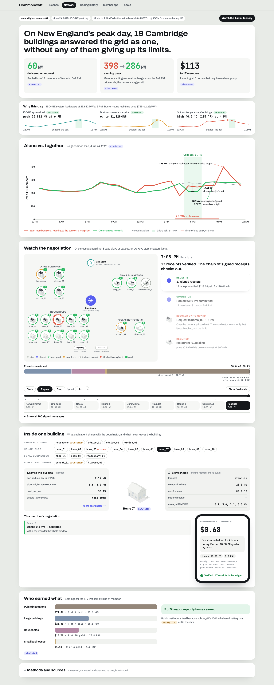
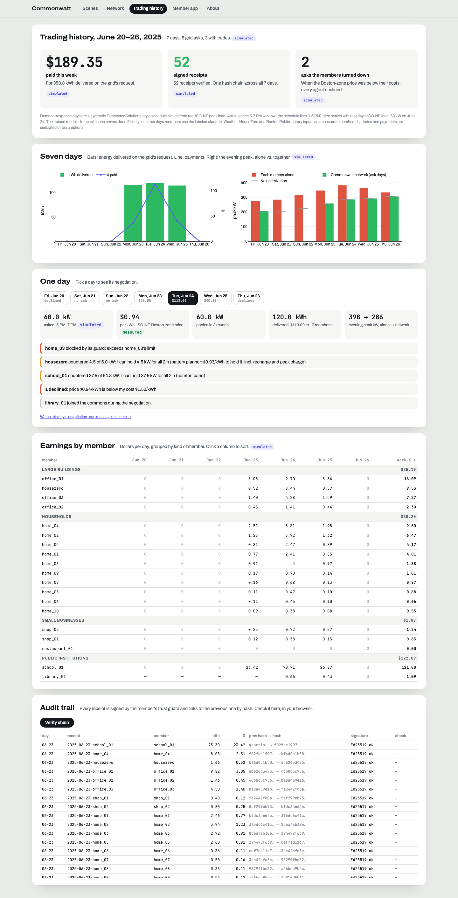
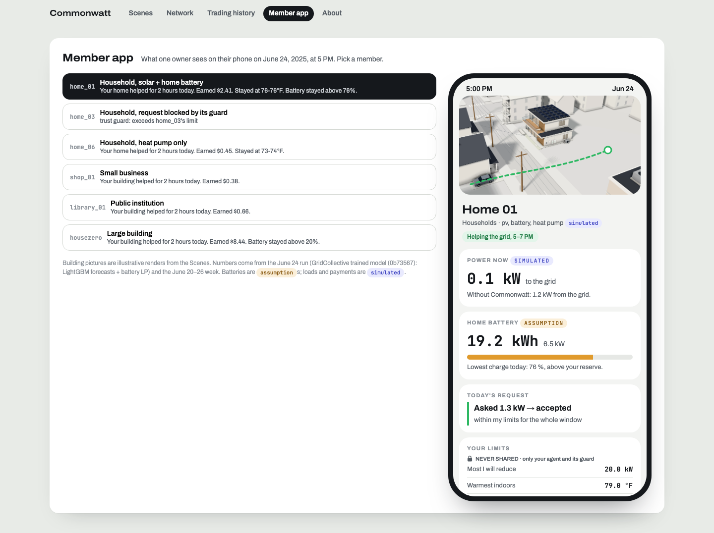

# MassWatt

**An agent network for Massachusetts' energy commons.** Every building gets an agent. Every neighborhood gets a network.

Hackachusetts 2026 · **Climate Tech track, challenge C3**: "clean power still has to show up at the peak".

- **Live demo:** https://rbynwang.github.io/MassHack/ (the `app/` folder, published by GitHub Pages)
- **How we used Kiro:** [KIRO_USAGE.md → Write-up](KIRO_USAGE.md#write-up)
- **Submission statement:** [docs/submission-statement.md](docs/submission-statement.md)

| Network replay | Trading history | Member app |
|---|---|---|
|  |  |  |

## The problem

Massachusetts is electrifying heat and cars, and on hot evenings everyone pulls power at once. The flexible
resources already exist (rooftop solar, home batteries, heat pumps that can pre-cool), but they sit in homes, shops
and public buildings that each optimize alone. When they all react to the same price, they create a new, later
peak. Grid programs mostly pay battery owners, and joining means handing your data and device control to a utility
or aggregator, so most buildings never take part.

## What MassWatt does

| Layer | What it does | Code |
|---|---|---|
| Grid agent | Turns ISO-NE conditions (Boston-zone price, system load) into an ask: "reduce 60 kW, 5–7 PM" | `src/commonwatt/agents/grid.py` |
| Coordinator (one per commons) | Collects offers, runs up to 3 negotiation rounds, staggers recharge so members don't spike together, settles payments. Sees offers only. | `src/commonwatt/agents/coordinator.py` |
| Trust guard (one per member) | Holds the owner's private limits, blocks requests that break them, measures delivery, signs hash-chained Ed25519 receipts | `src/commonwatt/trust.py` |
| Member agent (one per building) | Calls the ML model tool for its forecast and its decision: accept, counter or decline | `src/commonwatt/agents/member.py` |
| ML model tool | The team's trained GridCollective model: calibrated LightGBM P10/P50/P90 forecasts and a battery planner (linear program with the demand charge) | `src/commonwatt/tools/gridcollective.py`, `src/gridcollective/` |
| Protocol | 7 signed messages: agent card, ask, offer, request, response, assignment, receipt (JSON Schemas) | `src/commonwatt/protocol.py`, `protocol/schemas/` |

**June 24, 2025 (the ISO-NE peak day), 19 Cambridge members, simulated:** acting alone, the neighborhood's evening
peak is 398 kW; with the network, 286 kW. The grid asks for 60 kW from 5 to 7 PM; the commons pools 60.0 kW in
3 rounds and pays $113 to 17 members, including all 5 heat-pump-only homes. One home's guard blocks a request over
its owner's private limit, and a library joins mid-negotiation with no coordinator change. All 17 receipts verify.

## Run it

Requires Python 3.12 and [uv](https://docs.astral.sh/uv/).

```bash
uv sync
uv run commonwatt-demo        # June 24 negotiation -> app/data/demo.js, protocol/schemas/*.json
uv run commonwatt-week        # June 20-26 trading history, receipts chained across the week -> app/data/week.js
uv run pytest -q              # property-based tests (hypothesis) on limits, pooling, payouts and the ledger
open app/index.html           # the site; works offline from files
uv run python scripts/check_story.py   # every page at 1440 and 390 px: no console errors, no overflow
```

Choose the model tool with `COMMONWATT_TOOL=module:Class` (default: the trained GridCollective model; members it was
not trained on use a labeled stand-in, `commonwatt.tools.mock:MockModelTool`).

## The site (`app/`)

| Page | What it shows |
|---|---|
| `index.html` | Landing page with the June 24 results |
| `presentation/commonwatt-story.html` | Scenes: the 1-minute story in pre-rendered 3D (no WebGL needed) |
| `story.html` | Network: the negotiation replayed one signed message at a time; inside one building; who earned what |
| `history.html` | Trading history: seven days, earnings by member, and an audit trail you can verify in the browser |
| `member.html` | Member app: what one owner sees on their phone |
| `about.html` | The problem, the architecture diagram, the data |

## Repository map

```
.kiro/              Steering, specs (commonwatt-network, final-submission) and hooks
src/commonwatt/     Agent network: protocol, network (bus, registry), trust (guards, ledger), agents/, tools/, week.py
src/gridcollective/ The trained model's battery planner and physics (from branch model/gridcollective)
src/homesim/        Synthetic single-family home generator (config.yaml + seed)
app/                The static site (reads app/data/*.js written by the commands above)
protocol/schemas/   JSON Schemas of the 7 protocol messages
data/               HouseZero, Boston Public Library, training data, baselines (see each folder's README)
tests/              pytest + hypothesis
scripts/            Page checks (Playwright)
KIRO_USAGE.md       Running log of how Kiro was used, and the write-up
```

## Data and labels

Massachusetts data only. Every number on the site carries a label:
**measured** (from a meter or ISO-NE), **simulated** (from a model or simulator) or **assumption** (a value we chose).

| Input | Label | Source and license |
|---|---|---|
| HouseZero building load, solar and weather | measured | Harvard Center for Green Buildings and Cities, HouseZero one-year datasets, CC BY 4.0: [10.6084/m9.figshare.30260233.v1](https://doi.org/10.6084/m9.figshare.30260233.v1) (June 2024 – May 2025) and [10.6084/m9.figshare.32790984.v1](https://doi.org/10.6084/m9.figshare.32790984.v1) (June 2025 – May 2026) |
| Boston Public Library Central electricity | measured | City of Boston, Analyze Boston, PDDL |
| Grid price and load | measured | ISO New England real-time LMP (.Z.NEMASSBOST) and system load |
| Offices, shops, restaurant | simulated | NREL ComStock building designs used as physics templates, driven by HouseZero's measured weather |
| Households | simulated | `src/homesim`, calibrated to the National Grid R-1 residential load shape |
| School | assumption (size) | National Grid G-2 class load shape for the date, scaled |
| Demand-response days (June 20–26) | simulated | ConnectedSolutions-style schedule picked from real ISO-NE peak load |
| Home batteries, tariffs, comfort costs, price paid | assumption | Labeled in code and on each page |

Savings and payments are simulation results, not measured outcomes. This repository is not an official Harvard,
City of Boston or ISO-NE release.

## Team

Built at Hackachusetts 2026 by Robyn (Xuening) Wang and team (ML model and tooling: Robyn; agent network and site:
built with Kiro).
